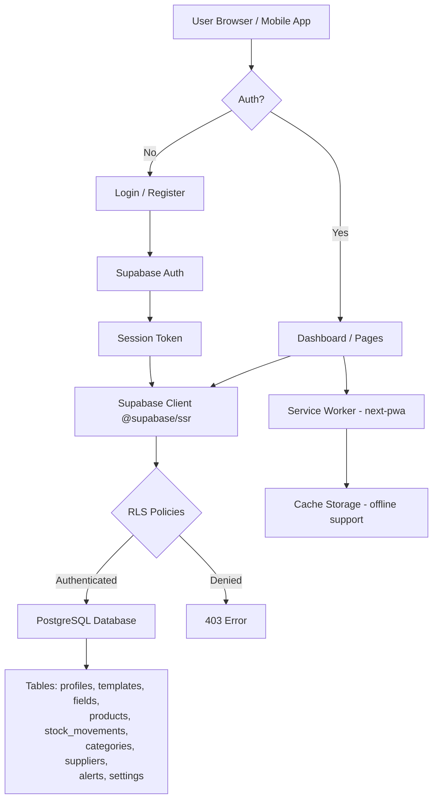
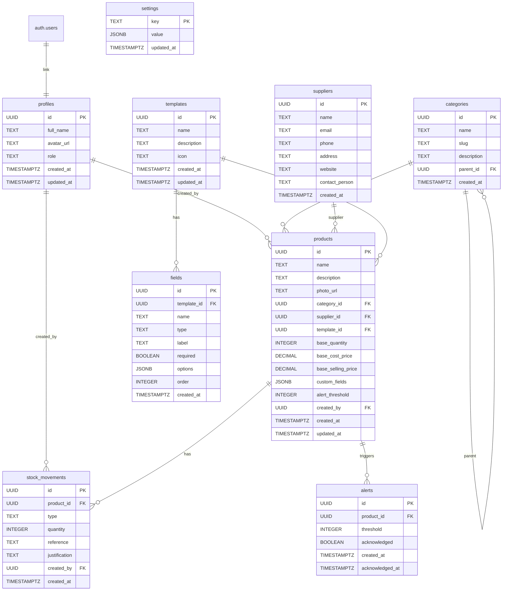

# Architecture Documentation

Technical architecture of Stocky — project structure, data flow, components, database schema, and security.

---

## Project Structure

```
stocky/
├── public/                          # Static assets
│   ├── manifest.json                # PWA manifest
│   ├── icon-*.png                   # PWA icons (various sizes)
│   ├── apple-touch-icon*.png        # iOS app icons
│   └── sw.js                        # Service worker (generated by next-pwa)
├── src/
│   ├── app/                         # Next.js App Router
│   │   ├── (auth)/                  # Auth route group
│   │   │   ├── login/page.tsx       # Login page
│   │   │   ├── register/page.tsx    # Registration page
│   │   │   ├── forgot-password/     # Password recovery
│   │   │   ├── reset-password/      # Reset password
│   │   │   ├── verify/              # Email verification
│   │   │   └── layout.tsx           # Auth layout
│   │   ├── (dashboard)/             # Protected route group
│   │   │   ├── page.tsx             # Dashboard (home)
│   │   │   ├── layout.tsx           # Dashboard layout (sidebar)
│   │   │   ├── loading.tsx          # Loading fallback
│   │   │   ├── dashboard/
│   │   │   │   ├── page.tsx         # Dashboard KPIs
│   │   │   │   └── alertes/         # Alerts page
│   │   │   ├── produits/
│   │   │   │   └── page.tsx         # Products CRUD
│   │   │   ├── mouvements/
│   │   │   │   └── page.tsx         # Stock movements
│   │   │   ├── templates/
│   │   │   │   └── page.tsx         # Template management
│   │   │   ├── categories/
│   │   │   │   └── page.tsx         # Category management
│   │   │   ├── fournisseurs/
│   │   │   │   └── page.tsx         # Supplier management
│   │   │   └── parametres/
│   │   │       └── page.tsx         # Settings page
│   │   ├── layout.tsx               # Root layout (metadata, providers)
│   │   ├── page.tsx                 # Home (redirects to /dashboard)
│   │   ├── globals.css              # Global styles (Tailwind + CSS vars)
│   │   └── sw.ts                    # Custom service worker config
│   ├── components/
│   │   ├── ui/                      # Shadcn/ui primitives
│   │   ├── layout/                  # Sidebar, header, theme toggle
│   │   ├── products/                # Product cards, forms, detail view
│   │   ├── movements/               # Movement forms, history
│   │   ├── templates/               # Template builder, field editor
│   │   ├── pwa/                     # Offline banner, install prompt
│   │   └── qr/                      # QR code generation, scanner
│   ├── context/
│   │   └── AuthContext.tsx          # Auth state provider
│   ├── lib/
│   │   ├── supabase/
│   │   │   ├── client.ts            # Browser Supabase client
│   │   │   ├── server.ts            # Server-side Supabase client
│   │   │   └── middleware.ts        # Auth middleware
│   │   └── utils.ts                 # Shared utility functions
│   └── hooks/
│       ├── use-offline.ts           # Online/offline state
│       └── use-products.ts          # Product data hooks
├── supabase/
│   └── migrations/                  # Database migrations (001–010)
├── capacitor.config.ts              # Capacitor configuration
├── next.config.js                   # Next.js + PWA config
├── tailwind.config.ts               # Tailwind CSS config
├── postcss.config.mjs               # PostCSS config
├── tsconfig.json                    # TypeScript config
├── vercel.json                      # Vercel deployment config
└── .github/
    └── workflows/
        └── ci.yml                   # GitHub Actions CI/CD
```

---

## Data Flow



### Request Flow (Product List Example)

```
1. User navigates to /dashboard/produits
2. Layout middleware checks Supabase session
3. Dashboard layout renders with sidebar
4. Products page calls useProducts() hook
5. Hook calls supabase.from('products').select('*')
6. Supabase client sends request with auth token
7. Supabase checks RLS policies
8. PostgreSQL returns matching products
9. React re-renders with data
10. Service worker caches the page for offline access
```

---

## Component Hierarchy

```
RootLayout (layout.tsx)
├── ThemeProvider (dark/light)
├── AuthProvider (session state)
│   ├── OfflineBanner (connection status)
│   ├── InstallPrompt (PWA install CTA)
│   ├── Sidebar (navigation)
│   ├── Main Content Area
│   │   ├── Dashboard Page
│   │   │   ├── KPICards
│   │   │   ├── StockChart
│   │   │   └── RecentMovements
│   │   ├── Products Page
│   │   │   ├── ProductTable
│   │   │   ├── ProductForm (create/edit)
│   │   │   ├── ProductDetail
│   │   │   ├── SearchFilterBar
│   │   │   └── QRCodeGenerator
│   │   ├── Movements Page
│   │   │   ├── MovementForm
│   │   │   └── MovementList
│   │   ├── Templates Page
│   │   │   ├── TemplateList
│   │   │   └── FieldBuilder
│   │   ├── Categories Page
│   │   │   └── CategoryTree
│   │   ├── Suppliers Page
│   │   │   └── SupplierTable
│   │   ├── Alerts Page
│   │   │   ├── AlertList
│   │   │   └── AlertActions
│   │   └── Settings Page
│   │       └── SettingsForm
│   └── Toaster (shadcn) + HotToaster (react-hot-toast)
```

---

## Database Schema Diagram



---

## PWA / Capacitor Architecture

### PWA (Web)

```
Browser
├── Next.js App (next-pwa plugin)
│   ├── Service Worker Registration (sw.ts)
│   ├── Precache: dashboard, produits, mouvements, categories, fournisseurs, alertes
│   ├── Runtime Caching: API responses via CacheFirst strategy
│   └── Fallback: offline fallback page
├── manifest.json (app metadata, icons, theme)
└── Workbox (caching, expiration, routing)
```

### Capacitor (Mobile Native)

```
Native App (Android/iOS)
├── Capacitor Core
│   ├── WebView hosting .next build output
│   └── Native Bridge (JS ↔ Native)
├── Capacitor Plugins:
│   ├── Camera → Photo capture for product images
│   ├── MLKit Barcode Scanning → QR/barcode scanning
│   ├── StatusBar → Status bar styling
│   ├── SplashScreen → Launch splash screen
│   ├── Keyboard → Keyboard resize behavior
│   └── Preferences → Local key-value storage
└── Native Projects:
    ├── android/ → Android Studio project (gitignored)
    └── ios/ → Xcode project (gitignored)
```

### Build Pipeline

```
Source Code (src/)
    ↓ npm run build
Next.js Standalone Output (.next/)
    ↓ cap sync
    ├── Web: served by Vercel Node.js server
    └── Mobile: loaded by Capacitor WebView
```

---

## Security Considerations

### Row Level Security (RLS)

All tables have RLS enabled. Every policy targets `TO authenticated`, ensuring:

- Only logged-in users can query, insert, update, or delete data
- Users can only access their own data (enforced by `auth.uid()` checks)
- The `update_updated_at_column()` function is safe (doesn't expose auth data)

### Authentication Flow

```
User → Supabase Auth → Session (JWT) → Supabase Client → PostgreSQL
```

- Session is stored in localStorage (via `@supabase/ssr`)
- Token refresh is automatic
- Sign-out clears the session

### Data Validation

- **Database-level:** CHECK constraints (e.g., `stock_movements.type IN ('IN', 'OUT')`), NOT NULL, foreign keys
- **Client-level:** Zod schemas for form validation
- **Form-level:** React Hook Form with resolver

### API Security

- No custom API routes — direct Supabase client access from the frontend
- Environment variables (`NEXT_PUBLIC_SUPABASE_*`) are safe for client exposure
- RLS policies enforce data isolation regardless of client permissions

### PWA Security

- HTTPS only (Vercel provisioned SSL)
- Service worker scope limited to app origin
- No eval() or dynamic script injection
